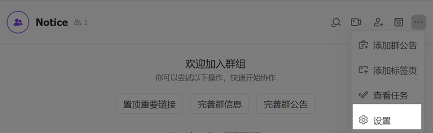
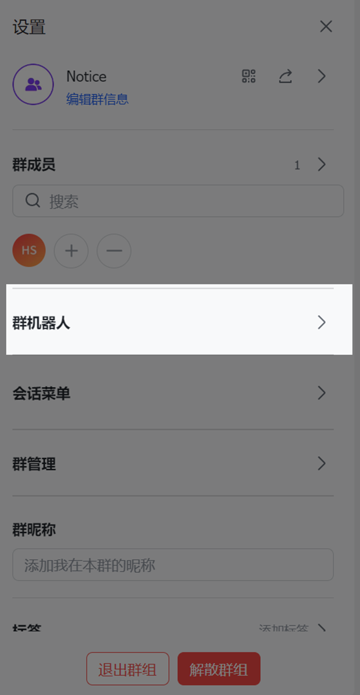
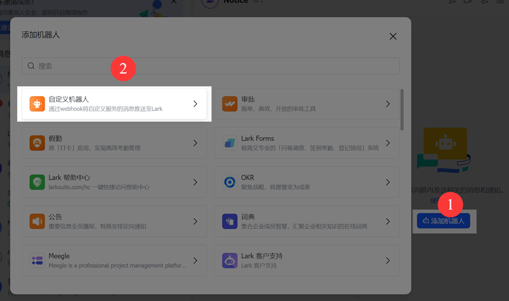
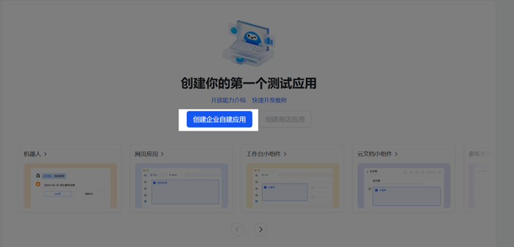
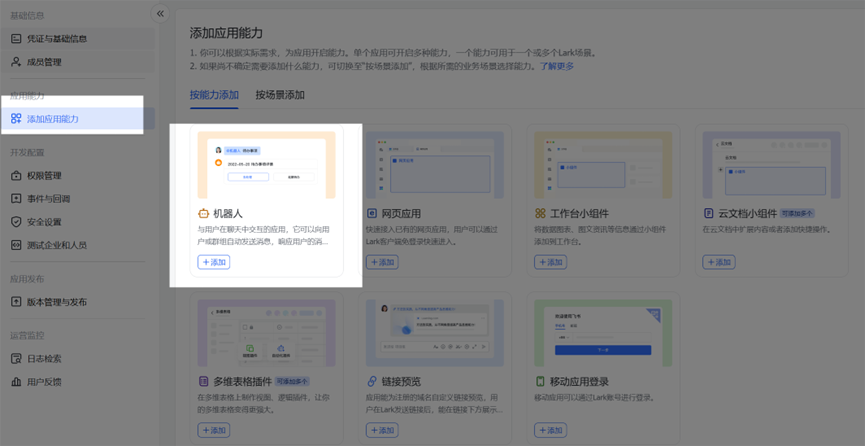
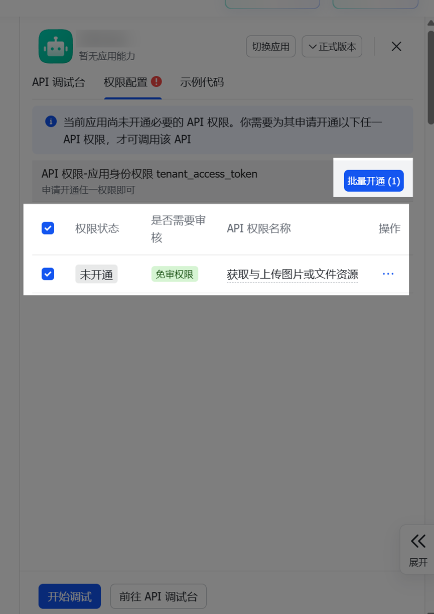
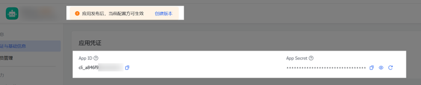
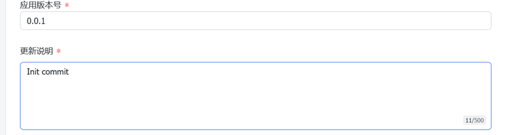

本页对应一条龙界面左侧导航 `「设置」-「通知设置」` 中的配置项，主要说明运行结果推送、各通知方式的界面配置项与配置步骤。不熟悉左侧各入口用途时，可先查看[界面导航](../gui_guide.md#设置)。

## 功能说明

通知设置决定「跑完之后怎么告诉你」，能做的事：

- **应用级通知**：应用开始、结束时各推一条，这两种可以分别关掉
- **节点级通知**：按 `仅失败` / `逐条` / `合并` 控制任务中途的通知粒度
- **附带截图**：通知里带上当时的游戏截图，全局一个开关
- **多方式同时推送**：配置好的渠道会全部收到同一条消息，不用二选一
- **按应用单独配置**：每个应用可以有自己的通知档位
- **免跑测试**：不用真跑一遍任务，点「测试当前方式」或「测试全部」就能验证

## 通知配置

下面分组列出支持的通知方式，点击标题展开各自的界面配置项与配置步骤，再点一次收起。

### 大众使用⭐⭐⭐

::: details SMTP邮件：支持图文，邮件推送，0门槛
特点：邮件推送，经典永不过时，支持多种安全设置

**界面配置项**

基础配置（必填）：
- `SMTP服务器`: SMTP服务器地址
- `SMTP端口`: 服务器端口
- `发件人邮箱`: 用于发送邮件的邮箱地址
- `邮箱密码`: 邮箱密码或应用专用密码
- `发件人名称`: 发件人显示的名称

安全设置（根据服务器要求配置）：
- `启用SSL`: 是否使用SSL加密（true/false）
- `启用STARTTLS`: 是否使用STARTTLS加密（true/false）

**配置步骤**

1. 准备邮箱配置信息，常见邮箱服务设置如下：

**Gmail邮箱**:
1. 基本配置：
   - SMTP服务器：`smtp.gmail.com`
   - 推荐：端口 `587` 且启用 STARTTLS（SSL 关闭）
   - 或者：端口 `465` 且启用 SSL（STARTTLS 关闭）
2. 特别设置：
   - 开启两步验证
   - 生成应用专用密码
   - 在密码栏填入应用专用密码

**QQ邮箱**:
1. 基本配置：
   - SMTP服务器：`smtp.qq.com`
   - SMTP端口：`465`
   - SSL：开启
   - STARTTLS：关闭
2. 特别设置：
   - 开启SMTP服务
   - 获取授权码
   - 在密码栏填入授权码

**163邮箱**:
1. 基本配置：
   - SMTP服务器：`smtp.163.com`
   - SMTP端口：`465`
   - SSL：开启
   - STARTTLS：关闭
2. 特别设置：
   - 开启SMTP服务
   - 获取授权码
   - 在密码栏填入授权码

**注意事项**

- 不同邮箱服务的安全设置可能不同
- 建议使用授权码而不是邮箱密码
- 测试配置时先发送测试邮件验证
:::

::: details 钉钉机器人：仅支持文字，群机器人，0门槛
特点：企业级服务，稳定可靠，安全性高

**界面配置项**

基础配置（必填其一）：
- `Token`: 钉钉机器人的访问令牌
  - 从webhook地址中提取`access_token=`后面的部分

安全设置（推荐）：
- `Secret`: 钉钉机器人的签名密钥
  - 在机器人创建时选择"加签"可获得

**配置步骤**

1. 创建机器人：
   - 打开钉钉群 -> 智能群助手 -> 添加机器人
   - 选择"自定义机器人"
   - 推荐选择"加签"安全设置方式

2. 获取配置信息：
   - Token获取：
     - 复制webhook地址（格式：`https://oapi.dingtalk.com/robot/send?access_token=abc123`）
     - 提取`access_token=`后面的部分填入界面"Token"输入框

   - Secret获取（如果选择加签）：
     - 复制显示的加签密钥
     - 填入界面"Secret"输入框

**注意事项**

- 推荐同时配置Token和Secret
- 使用加签可以提高安全性
- 注意消息发送频率限制
:::

::: details 飞书/Lark 机器人：支持图文，群机器人，0门槛
特点：功能丰富，消息可富文本排版

*先进团队，先用飞书*

**界面配置项**

基础配置（仅文本消息）：
- `密钥`: 飞书机器人的webhook密钥（必填）
  - 从webhook地址中提取最后一段字符串

图片消息支持（可选）：
- `自建应用 App ID`: 用于发送图片的应用ID
- `自建应用 Secret`: 用于发送图片的应用密钥

**配置步骤**

可参考[使用自定义机器人发送飞书卡片](https://open.feishu.cn/document/feishu-cards/quick-start/send-message-cards-with-custom-bot)和[上传图片](https://open.feishu.cn/document/server-docs/im-v1/image/create)了解更多。

飞书和Lark的配置大同小异，但是网页端口不一致。

1. 登录飞书/Lark客户端并创建一个群聊。
   - 打开群聊的*设置*界面，
   
   - 点击*群机器人*，
   
   - 选择*添加机器人*>*自定义机器人*。
   
   - 复制webhook地址，如：`https://open.feishu.cn/open-apis/bot/v2/hook/abc123def456`

    ::: warning
    请妥善保存好此 webhook 地址，不要公布在 Gitlab、博客等可公开查阅的网站上，避免地址泄露后被恶意调用发送垃圾消息。你也可以增加 安全设置，以保证信息安全。
    :::

   - 提取最后一段`abc123def456`填入界面"Webhook地址后缀"输入框

2. 图片支持配置（可选）：
   - 访问[飞书开放平台](https://open.feishu.cn/app) 或[Lark开放平台](https://open.larksuite.com/app)
   - 创建或选择一个应用.
     
   - 点击"添加应用能力"页面，赋予*机器人*能力。
     
   - 前往[飞书上传图片api](https://open.feishu.cn/document/server-docs/im-v1/image/create) 或[Lark上传图片api](https://open.larksuite.com/document/server-docs/im-v1/image/create)，给予应用*上传图片*权限。
     
   - 保存后前往应用基础页面，记录下你的appid和appsecret，并点击*创建版本*。
     
   - 写点东西发版
     
   - 在一条龙app内
     - 复制"App ID"填入界面"自建应用 App ID"输入框
     - 复制"App Secret"填入界面"自建应用 Secret"输入框
:::

::: details QQ 官方机器人：支持图文，QQ 官方接口，0门槛
特点：调用 QQ 开放平台的官方机器人接口推送到 QQ 单聊/群聊，不需要部署 OneBot、NapCat 之类的协议端，配置简单

**界面配置项**

- `机器人 AppID`：QQ 开放平台 `机器人 - 开发设置` 里的 AppID（必填）
- `机器人 AppSecret`：同一页面的 AppSecret（必填）
- `自动获取接收方`：绑定按钮组，分 `绑定单聊`、`绑定群聊` 和绑定过程中的 `取消`
- `单聊 OpenID`：接收私聊消息的用户 OpenID（与群聊至少填一项）
- `群聊 GroupOpenID`：接收消息的群 GroupOpenID（与单聊至少填一项）

> 接收方的 `openid` / `group_openid` 在开放平台没有查询接口，只能从机器人收到的消息事件里取，所以不要手填，务必点上面的绑定按钮自动获取。

**配置步骤**

1. 创建机器人：
   - 打开 [QQ 开放平台](https://q.qq.com/) 注册开发者账号并创建一个机器人
   - 在 `机器人 - 开发设置` 里复制 `AppID` 与 `AppSecret`

2. 填写凭据：
   - 在一条龙的 `设置 - 通知设置 - QQ 官方机器人` 中填入上面两项

3. 绑定接收方（单聊、群聊可以只绑一个，也可以都绑）：
   - `绑定单聊`：点下去后界面会弹出一条常驻提示，给出一个 4 位验证码，**60 秒内**用手机 QQ 私聊这个机器人把这 4 位数字发过去（把机器人加为好友也会直接完成绑定）；成功后 `单聊 OpenID` 自动填入
   - `绑定群聊`：点下去后把机器人拉进目标群，或者在群里 `@机器人` 发送提示里的 4 位验证码；成功后 `群聊 GroupOpenID` 自动填入
   - 等不及可以在弹窗里点 `取消`，绑定最多等 60 秒

4. 验证配置：
   - 使用一条龙的测试功能发送测试消息
   - 确认单聊/群聊能正常收到

**注意事项**

- 绑定按钮也要求先填好 `AppID` 与 `AppSecret`，否则会直接提示先填写凭据
- 绑定过程是直连 QQ 网关的，**不走**通知设置里的代理选项；只有正式推送时才走
- 单聊需要对方先把机器人加为好友，否则会报「机器人还没添加对方为好友」
- 群聊的主动消息需要**群主**在手机 QQ 的群机器人设置里打开「机器人在群内主动发言」，否则会报「主动消息无权限」
- 接收方如果收不到，需要他在手机 QQ 打开该机器人资料页，开启「接收机器人推送」
- 频率限制：同一个接收方每分钟最多 20 条、每天最多 1000 条，触发后会提示「主动消息发送太频繁」
- 消息以 markdown 格式发送，标题会渲染成二级标题；截图通过富媒体分片上传，图片发送失败只会降级为纯文本，不影响文字送达
- 单聊和群聊都绑定时会各推一份；只要有一个接收方没收到，推送结果就按失败处理，方便发现问题
- 绑定时提示「鉴权失败」，一般是 `AppID`/`AppSecret` 填错，或者机器人还没开通对应的事件权限，去开放平台的机器人能力配置里确认一下
:::

::: details 企业微信机器人：支持图文，群机器人，0门槛
特点：企业级服务，配置简单

**界面配置项**

基础配置（必填）：
- `企业微信机器人 Key`: 机器人webhook的key
  - 从webhook地址中提取`key=`后面的部分

代理配置（可选）：
- `企业微信代理地址`: 自定义API地址
  - 默认为 `https://qyapi.weixin.qq.com`
  - 支持自定义代理地址

**配置步骤**

1. 创建机器人：
   - 打开企业微信群聊
   - 点击群聊名称进入群设置
   - 选择"添加机器人"或"群机器人"选项
   - 选择"自定义机器人"
   - 为机器人命名（可自定义）

2. 获取机器人 Key：
   - 机器人创建后会生成webhook地址，格式为：
     ```
     https://qyapi.weixin.qq.com/cgi-bin/webhook/send?key=abc123xyz
     ```
   - 提取`key=`后面的部分（例如：`abc123xyz`）
   - 填入界面"企业微信机器人 Key"输入框

3. 代理地址配置（可选）：
   - 默认使用官方API地址，无需修改
   - 如果需要使用自定义代理地址，填入"企业微信代理地址"输入框
   - 支持国内代理或自建反向代理

4. 验证配置：
   - 使用一条龙的测试功能发送测试消息
   - 确认消息能正常显示在群聊中

**注意事项**

- 支持同时发送文本和图片消息
- 单条消息中文本优先发送，图片后发送
- 图片大小限制为2MB以内
- 如果发送失败，只要文本消息成功就会返回成功状态
- 机器人需要具有发送消息权限
:::

### 进阶使用⭐⭐

::: details 企业微信应用：支持图文，企业自建应用，要企业管理后台权限
特点：企业级功能，需要管理权限

**界面配置项**

基础配置（必填）：
- `企业 ID`: 企业微信的企业ID
- `应用 Secret`: 自建应用的Secret
- `应用 AgentID`: 自建应用的AgentID
- `接收者 ID`: 消息接收者，支持成员ID、部门ID或@all（可选，默认@all）

**配置步骤**

1. 登录企业微信管理后台：
   - 访问[企业微信后台](https://work.weixin.qq.com/wework_admin/loginpage_wx)
   - 使用企业管理员账号登录

2. 获取企业ID：
   - 在"我的企业"页面
   - 找到"企业信息"部分，复制"企业ID"
   - 填入界面"企业 ID"输入框

3. 创建或选择自建应用：
   - 进入"应用管理" -> "自建"
   - 点击"创建应用"或选择已有应用
   - 获取以下信息：
     * `Secret`: 在应用详情页的"Secret"部分，复制并填入界面"应用 Secret"输入框
     * `AgentID`: 在应用详情页找到AgentID，复制并填入界面"应用 AgentID"输入框

4. 设置消息接收者：
   - 在应用详情页的"可见范围"部分配置接收者
   - 在界面"接收者 ID"输入框填写：
     * `@all`: 发送给所有成员（推荐）
     * 其他的不做介绍，当局者清，请良心使用一条龙的推送功能

5. 验证配置：
   - 使用一条龙的测试功能发送测试消息
   - 确认消息能正常接收

**注意事项**

- 应用需要具有"消息型应用"的性质
- Secret和AgentID需要正确对应
- 确保应用在"可见范围"中包含目标接收者
- 支持同时发送文本消息和图文消息（带图片）
- 图文消息发送失败时会自动回退到文本消息
:::

::: details OneBot：支持图文，QQ 协议端转发，要自己部署并保活
特点：对接自建的 QQ 协议端（NapCat / go-cqhttp）转发消息，支持合并转发，但需要自己部署并维护协议端；不想额外部署时可以用上面的 QQ 官方机器人

**界面配置项**

服务配置：
- `请求地址`: OneBot 协议端（NapCat / go-cqhttp 等）的 HTTP 服务地址（必填，按协议端实际端口填写，默认 `http://127.0.0.1:5700`）
- `Token`: API访问令牌（可选，取决于协议端配置）

消息接收配置（至少填写一项）：
- `QQ 号`: 接收私聊消息的QQ号
- `群号`: 接收群聊消息的群号

**配置步骤**

1. 环境准备：
   - 确保 OneBot 协议端（NapCat / go-cqhttp 等）已正确安装和配置
   - 确保协议端的 HTTP 服务正常运行，并且开着能收发消息的 QQ 账号

2. 基础配置：
   - `请求地址`：
     - 本地部署填写：`http://127.0.0.1:5700`
     - 远程部署填写实际服务器地址
   - `Token`：
     - 如果go-cqhttp配置了访问令牌，需要填写
     - 否则可以留空

3. 消息接收配置（至少选择一项）：
   - 私聊消息：填写接收消息的QQ号
   - 群聊消息：填写接收消息的群号
   - 可以同时配置，消息会同时发送到私聊和群聊

4. 验证配置：
   - 使用一条龙的测试功能发送测试消息
   - 确认消息能正常接收
:::

::: details 通用Webhook：支持图文，自定义 HTTP 请求，要自己写接收端
特点：完全自定义，适合有计算机技术能力且想自由推送

**界面配置项**

- `URL`：接收推送的 Webhook 地址（必填）
- `HTTP 方法`：`POST` / `GET` / `PUT`，默认 `POST`
- `Content-Type`：`application/json` / `application/x-www-form-urlencoded` / `application/xml` / `text/plain`，默认 `application/json`
- `请求头 (Headers)`：自定义请求头，填 JSON（可选）
- `请求体 (Payload)`：请求体模板，支持下面列出的变量（可选）

**请求头和请求体的写法**

界面「请求头 (Headers)」输入框填：

```json
{
  "Authorization": "Bearer your-token",
  "Custom-Header": "value"
}
```

界面「请求体 (Payload)」输入框填（模板示例）：

```json
{
  "text": "${title}",
  "message": "${content}",
  "timestamp": "${timestamp}"
}
```

支持的变量：
- `$title`, `{{title}}`: 通知标题
- `$content`, `{{content}}`: 通知内容
- `$timestamp`, `{{timestamp}}`: 当前时间(YYYY-MM-DD HH:mm:SS)
- `$iso_timestamp`, `{{iso_timestamp}}`: ISO格式时间
- `$unix_timestamp`, `{{unix_timestamp}}`: UNIX时间戳
- `$image`: 图片base64编码(当提供图片时)
:::

### 新手推荐⭐⭐⭐

::: details Server酱：仅支持文字，微信推送，0门槛
特点：配置简单，可免费使用app版，Turbo版支持微信接收，适合个人用户

**界面配置项**

- `PUSH_KEY`: Server酱的发送密钥（必填）
  - 支持新版格式：`SCT123456...`（推荐）
  - 支持旧版格式：`SCU123456...`

**配置步骤**

1. 获取SendKey：
   - 访问[server酱³](https://sc3.ft07.com/sendkey)或[Server酱·Turbo版](https://sct.ftqq.com/sendkey)并登录账号
   - 登录后获取SendKey
2. 在一条龙设置界面：
   - 找到"PUSH_KEY"输入框
   - 填入获取的SendKey

**注意事项**

- server酱³（server酱免费app版），折腾完可以下载[server酱](https://sc3.ft07.com/client)应用（兼容市面上几乎所有手机系统），来接收消息
- server酱·Turbo版（支持多渠道推送），免费版每天有额度限制，完全不够用故必须订阅会员，支持微信扫码绑定来接收消息
:::

::: details Bark：仅支持文字，iOS 推送，0门槛
特点：iOS设备专用，配置极简，通知效果好

**界面配置项**

- `推送地址或 Key`: 填写Bark推送密钥或完整地址（必填）
  - 方式1：填写从Bark APP获取的推送密钥
  - 方式2：填写自建服务器的完整URL
- `推送分组`: 消息分组名称（可选）
- `推送铃声`: 通知声音（可选）
- `推送图标`: 通知图标URL（可选）
- `推送中断级别`: 通知重要程度（可选）

**配置步骤**

1. 下载安装：
   - 在App Store搜索安装Bark
   - 或者自建服务器部署

2. 获取推送密钥：
   - 打开APP，直接复制显示的URL
   - 提取URL最后的密钥部分

3. 在一条龙设置界面填写：
   - 必填：`推送地址或 Key`
   - 可选：根据需要配置其他选项

**注意事项**

- 仅支持iOS设备
- 可以自建服务器使用
- 支持丰富的通知效果
:::

::: details PushPlus：仅支持文字，微信推送，0门槛
特点：微信推送服务，配置简单，支持多种模板

**界面配置项**

- `用户令牌`: PushPlus平台获取的Token（必填）
- `群组编码`: 群组消息编码（可选）
- `发送模板`: 消息格式模板（可选）
- `发送渠道`: 推送渠道选择（可选）
- `Webhook 编码`: 自定义渠道配置（可选）
- `发送结果回调地址`: 推送结果通知地址（可选）

**配置步骤**

1. 获取Token：
   - 访问 PushPlus 官网
   - 注册并登录
   - 复制个人中心的Token

2. 基础配置：
   - 填写Token到"用户令牌"输入框
   - 如需群发，填写群组编码

3. 高级配置（可选）：
   - 选择消息模板
   - 配置推送渠道
   - 设置回调地址

**注意事项**

- 免费用户有API调用限制
- 支持多种消息模板
- 微信接收稳定可靠
:::

### 特殊需求⭐

::: details Discord：支持图文，私聊推送，要能访问 discord.com
特点：国际化服务，需要特殊网

暂无详细说明。排查就到这里为止，剩下的因为连我都没有用过。
:::

::: details Telegram：支持图文，私聊与群组，要能访问 telegram.org
特点：国际化服务，需要特殊网

**界面配置项**

基础配置（必填）：
- `BOT_TOKEN`: Telegram机器人Token
- `用户 ID`: 接收消息的用户或群组ID

代理配置（可选，国内用户建议配置）：
- `代理 URL`: 代理服务器地址
- `代理端口`: 代理服务器端口
- `API_HOST`: 自定义API地址

**配置步骤**

1. 创建机器人并获取Token：
   - 在Telegram中找到 @BotFather
   - 发送 `/newbot` 创建新机器人
   - 按提示设置机器人名称
   - 复制获得的Bot Token填入界面"BOT_TOKEN"输入框

2. 获取接收消息的ID：
   - 个人ID获取：
     * 找到 @userinfobot
     * 向其发送任意消息
     * 复制回复中的数字ID
   - 群组ID获取：
     * 将机器人加入群组
     * 在群组中发送消息
     * 通过API获取群组ID
   - 将获得的ID填入界面"用户 ID"输入框

3. 代理配置（国内用户）：
   - 准备代理服务器信息
   - 填写代理地址到"代理 URL"输入框
   - 填写代理端口到"代理端口"输入框
   - 如果使用自定义API地址，填入"API_HOST"输入框

**注意事项**

- 国内用户需要配置代理才能正常使用
- 确保机器人已经与用户或群组建立了对话
- 测试时建议先用个人ID进行测试
:::

::: details Ntfy：支持图文，主题订阅推送，0门槛
特点：开源免费、基于HTTP协议的轻量级消息推送服务，无需注册账号就能使用

**界面配置项**

基础配置：
- `TOPIC`: 通知主题名称（必填）
- `URL`: ntfy服务器地址（可选，默认 ntfy.sh）
- `消息优先级`: 通知优先级（可选，1-5）

认证配置（可选其一）：
- `TOKEN`: 访问令牌认证
- 用户名密码认证：
  - `用户名称`: ntfy用户名
  - `用户密码`: ntfy密码

高级配置：
- `用户动作`: 自定义操作按钮配置

**配置步骤**

1. 基础配置：
   - 确定使用的ntfy服务器：
     * 官方服务器：使用默认URL `https://ntfy.sh`
     * 自建服务器：填写您的服务器地址
   - 创建主题名称并填入"TOPIC"输入框
   - 根据需要设置消息优先级（1-5）：
     * 1：最低优先级
     * 2：低优先级
     * 3：普通优先级（默认）
     * 4：高优先级
     * 5：紧急优先级

2. 认证配置（根据服务器要求选择）：
   - 方式1 - 访问令牌：
     * 从ntfy服务获取访问令牌
     * 填入"TOKEN"输入框
   - 方式2 - 用户名密码：
     * 填写ntfy账户的用户名和密码
     * 分别填入"用户名称"和"用户密码"输入框

3. 高级配置（可选）：
   - 配置自定义操作按钮
   - 在"用户动作"输入框中填写按钮配置

**注意事项**

- 确保主题名称在服务器上是唯一的
- 根据消息重要程度选择合适的优先级
- 使用官方服务器时注意流量限制
:::

### 小众需求⭐

::: details Gotify：仅支持文字，私有化推送，要自己部署服务端
特点：自建推送服务，适合私有化部署

**界面配置项**

- `Gotify 地址`：Gotify 服务器地址（必填），如 `http://your-gotify-server`
- `App Token`：在 Gotify 里创建应用后拿到的令牌（必填）
- `消息优先级`：下拉选择 `0`~`5`，默认 `5`（数字越大越优先）

**配置步骤**

1. 部署 Gotify 服务器，或使用已有的服务器
2. 在 Gotify 里创建应用，拿到 App Token
3. 消息优先级在界面下拉里选，可选 `0`~`5`，数字越大越优先，默认 `5`
:::

::: details 智能微秘书：仅支持文字，微信推送，要邀请码才能注册
特点：推送到微信联系人或群，按名称指定接收方

**界面配置项**

- `APIKEY`：微秘书平台的 API 密钥（必填）
- `目标类型`：`contact`（私聊）/ `room`（群聊），默认 `contact`
- `目标名称`：接收消息的联系人或群名称（必填）
:::

::: details WxPusher：仅支持文字，微信推送，0门槛
特点：微信小众推送方案

**界面配置项**

- `appToken`：WxPusher 应用的 appToken（必填）
- `TOPIC_IDs`：主题 ID，多个用 `;` 分隔（与 UIDs 至少填一项）
- `UIDs`：用户 UID，多个用 `;` 分隔（与 TOPIC_IDs 至少填一项）

**配置步骤**

1. 登陆 WxPusher 官网
2. 注册后创建应用，获取appToken
3. 网页上，用你的微信号扫二维码关注应用，在用户列表可以获取到UID
4. 该平台已经无法推送微信公众号，需要在公众号上点击推送服务->下载APP后接收
:::

## 通用配置

### 1. 基础配置

1. 打开一条龙界面，左侧 `设置` → `通知设置`
2. 在「通知方式」下拉里选一种方式，下方会展开该方式的配置项
3. 填完点「测试当前方式」验证

> 不需要二选一：所有填写完整、通过校验的方式都会**同时**收到同一条通知，换方式时不用删掉旧的。

### 2. 全局配置项

| 配置项 | 说明 |
| --- | --- |
| `自定义通知标题` | 通知的标题，留空则使用默认的 `一条龙运行通知` |
| `通知中附带图片` | 关闭后所有方式都不再发送游戏截图 |
| `代理设置` | `不启用` / `个人代理`；境外服务（Telegram、Discord 等）连不上时选个人代理 |
| `个人代理地址` | 仅当选「个人代理」时填写，沿用脚本环境的个人代理 |

### 3. 应用通知

一条龙运行界面 `运行设置` 里的「应用通知」是总开关，右侧「设置」按钮进入逐个应用的配置。列表就是一条龙里的全部应用（兑换码、影像店营业、体力刷本、恶名狩猎等），每个应用一行，两个下拉分别管应用级和节点级通知：

| 下拉 | 可选值 | 说明 |
| --- | --- | --- |
| `应用` | `关闭` / `仅结束` / `开始和结束` | 应用开始、结束时是否各发一条 |
| `节点` | `关闭` / `仅失败` / `逐条` / `合并` | `逐条` 是每个标记节点完成就发一条，`合并` 收成应用结束时的一条汇总 |

另有全局开关「合并模式失败节点立即通知」：`节点` 选 `合并` 时，失败节点仍会立刻单独推一条，不用等应用跑完。

## 测试验证

不用真跑一遍任务，通知设置页的「测试通知方式」那里有两个按钮：

- `测试当前方式`：只测「通知方式」下拉里选中的那一种，适合刚填完一个渠道就验证
- `测试全部`：把已配置的方式都发一遍，适合确认每个渠道都通

测试在后台发送，不会卡住界面，结果直接弹提示。

通用Webhook 还有「生成 cURL 命令」（`PowerShell 风格` / `Unix 风格`），会把当前配置拼成一条现成的请求命令并复制到剪贴板，粘到终端就能复现，排查对端问题时很好用。

## 安全提示

- 密钥、Token 只存在本机配置里，发截图前先确认没有露出来；排查问题时也不要把完整配置文件发给别人
- Webhook、自建服务尽量用 HTTPS，带 token 的完整 URL 不要发到公开群
- 长期不用的密钥定期重置，怀疑泄露就去服务端重新生成

## 故障自助排查指南

推送是异步发出的，失败不会影响脚本运行，只是收不到消息。按下面顺序查，多数问题在前两步就能定位。

### 1. 先自查三件事

1. **必填项**：界面上带 `*` 的项都填了，且没有多余空格
2. **网络**：能连上对方域名
   ```bash
   ping qyapi.weixin.qq.com          # 换成你用的服务域名
   curl -I https://qyapi.weixin.qq.com
   ```
3. **配置**：点「测试当前方式」看返回的报错原文

防火墙、杀毒软件拦截通常表现为「连接超时」，可以先临时关掉试试。

### 2. 常见返回与处理

| 返回 | 含义 | 处理 |
| --- | --- | --- |
| `401` | 未授权 | 密钥 / Token 填错或已失效，重新生成后重填 |
| `403` | 权限不足 | 机器人被移出群、IP 不在白名单、缺少接口权限 |
| `404` | 接口不存在 | 地址写错，或对端没开对应接口 |
| `5xx` | 服务器错误 | 对端故障，过一会儿再试 |
| 超时 / `timeout` | 连不上 | 检查网络与代理，境外服务需在「代理设置」里选个人代理 |

后台日志会记一条「推送失败」并带上渠道名和错误信息，通常比界面提示更细，对着上表看即可。

企业微信可以手动验证凭据是否有效（PowerShell）：

```powershell
Invoke-WebRequest -Uri "https://qyapi.weixin.qq.com/cgi-bin/gettoken?corpid=您的ID&corpsecret=您的Secret"
```

> 文档有错漏或想补充通知方式，欢迎前往[issue](https://github.com/OneDragon-Anything/onedragon-anything.github.io/issues)反馈。

